# follower-log-vorlage

Wer folgt dir auf GitHub, und wer ist wieder gegangen? Diese Vorlage legt dir ein privates Logbuch an und bringt eine kleine App fürs Handy mit, die beim Öffnen nachsieht.

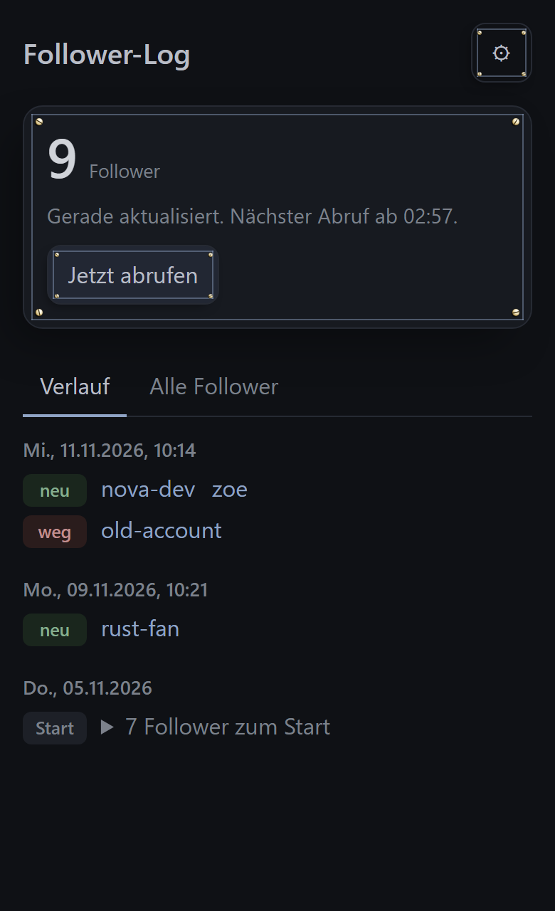 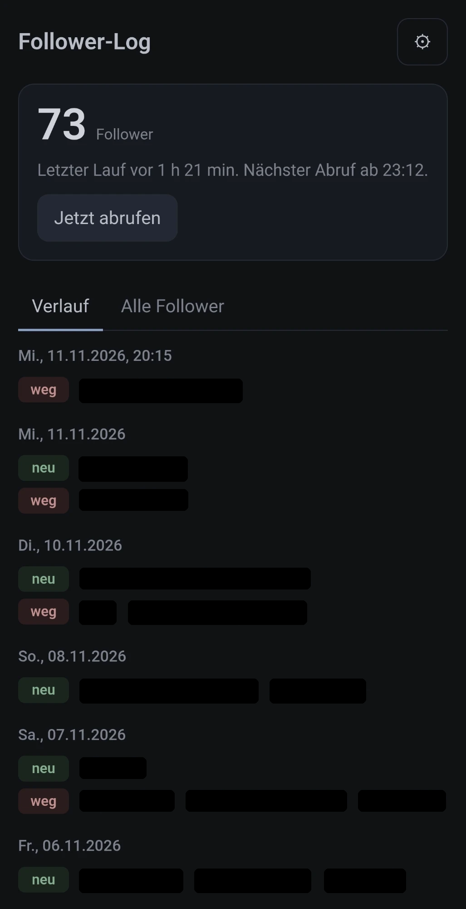

Links die Demo mit erfundenen Namen, rechts die App auf meinem Handy mit meinem echten Logbuch. Die Namen habe ich geschwärzt.

**App:** https://dennismit2n.github.io/follower-log-vorlage/ (zum Ausprobieren ohne Konto: [Demo](https://dennismit2n.github.io/follower-log-vorlage/?demo))

## Was passiert

- Ein GitHub-Actions-Workflow holt einmal am Tag (09:09 UTC) die Liste deiner Follower und vergleicht sie mit dem letzten Stand.
- `followers.txt` enthält die aktuelle Liste, `log.md` das Logbuch mit den neuesten Einträgen oben: **neu** folgt seitdem, **weg** folgt nicht mehr. Jeder Name verlinkt auf das Profil.
- Die App startet den Workflow beim Öffnen, aber höchstens einmal alle 178 Minuten. Geplante Läufe zählen mit. Ist die Sperre aktiv, lädt sie nur das Logbuch neu und zeigt, ab wann der nächste Abruf geht.
- Der Bot committet als `follower-bot`, damit nichts in deinem Beitragsgraphen landet.

## Einrichten (etwa fünf Minuten)

Du brauchst ein GitHub-Konto und dein Handy. Das bewegte Bild zeigt alle zehn Schritte nacheinander. Darunter steht jeder Schritt einzeln, mit Bild zum Aufklappen. Dieselbe Anleitung gibt es als Seite, die sich auf dem Handy gut liest: **https://dennismit2n.github.io/follower-log-vorlage/anleitung/**

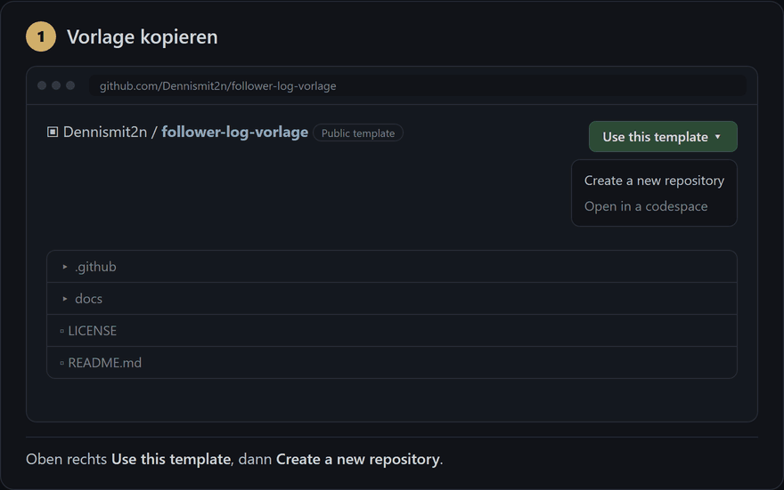

### Teil A: dein Logbuch anlegen

**1. Vorlage kopieren.** Oben auf dieser Seite auf *Use this template*, dann *Create a new repository*. Du bekommst eine eigene Kopie, die mit der Vorlage nichts mehr zu tun hat.

Bild zu Schritt 1

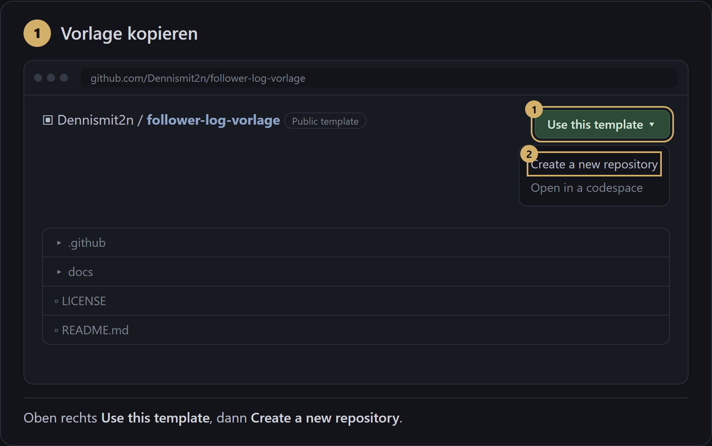

**2. Als privates Repo anlegen.** Name zum Beispiel `follower-log`. Bei *Visibility* unbedingt **Private** wählen, sonst kann jeder lesen, wer dir folgt und wer gegangen ist. Dann *Create repository*.

Bild zu Schritt 2

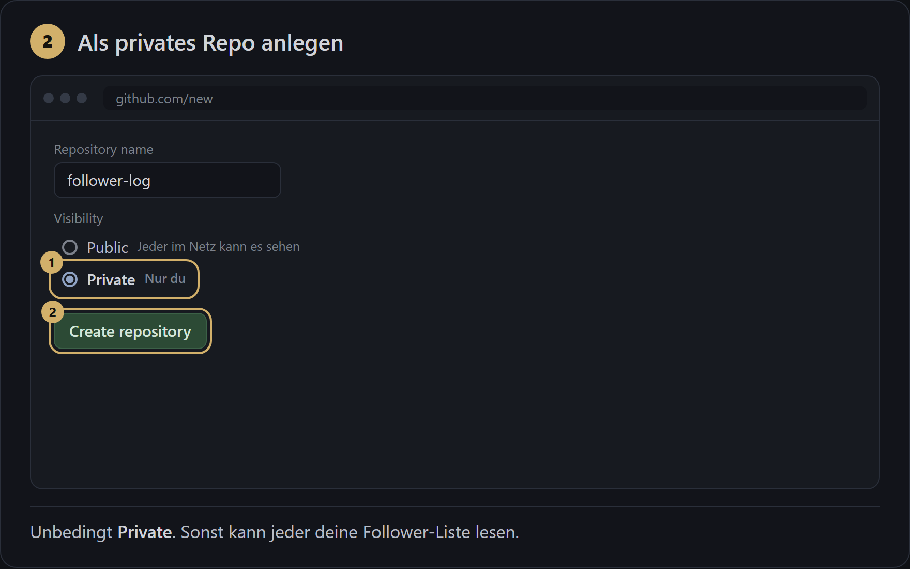

**3. Den ersten Lauf starten.** In deinem neuen Repo: Reiter *Actions*, links *Follower-Tracker*, rechts *Run workflow* und im kleinen Menü noch einmal der grüne Knopf *Run workflow*. Nach etwa einer halben Minute liegen `followers.txt` und `log.md` im Repo. Der erste Eintrag heißt *Startbestand* und listet alle bisherigen Follower. Ab jetzt läuft das jeden Tag von selbst.

Bild zu Schritt 3

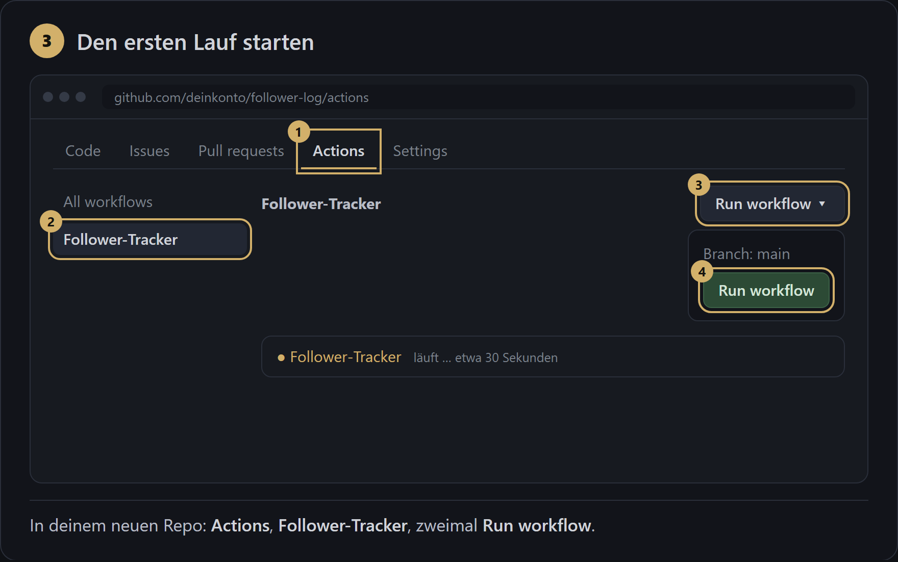

### Teil B: der Token

Die App läuft nur in deinem Browser und hat kein eigenes Konto. Damit sie deinen Workflow starten und dein privates Logbuch lesen darf, braucht sie einen Schlüssel von dir: einen Token. Am einfachsten machst du Teil B gleich auf dem Handy, dann kannst du den Token direkt in die App einfügen.

**4. Zur Token-Seite.** Auf GitHub: Profilbild oben rechts, *Settings*, ganz unten links *Developer settings*, *Personal access tokens*, *Fine-grained tokens*, *Generate new token*. Schneller: https://github.com/settings/personal-access-tokens/new

Bild zu Schritt 4

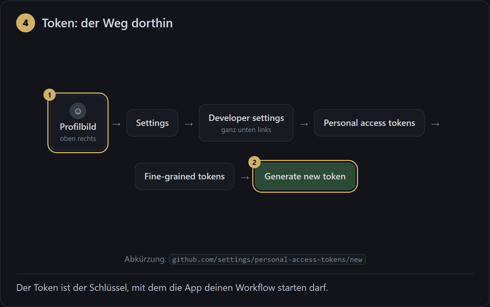

**5. Nur für dein Logbuch-Repo.** *Token name* frei wählbar, etwa `follower-log-app`. *Expiration* legt fest, wie lange er gilt. Bei *Repository access* **Only select repositories** wählen und nur dein Logbuch-Repo ankreuzen. So kommt der Token an nichts anderes heran.

Bild zu Schritt 5

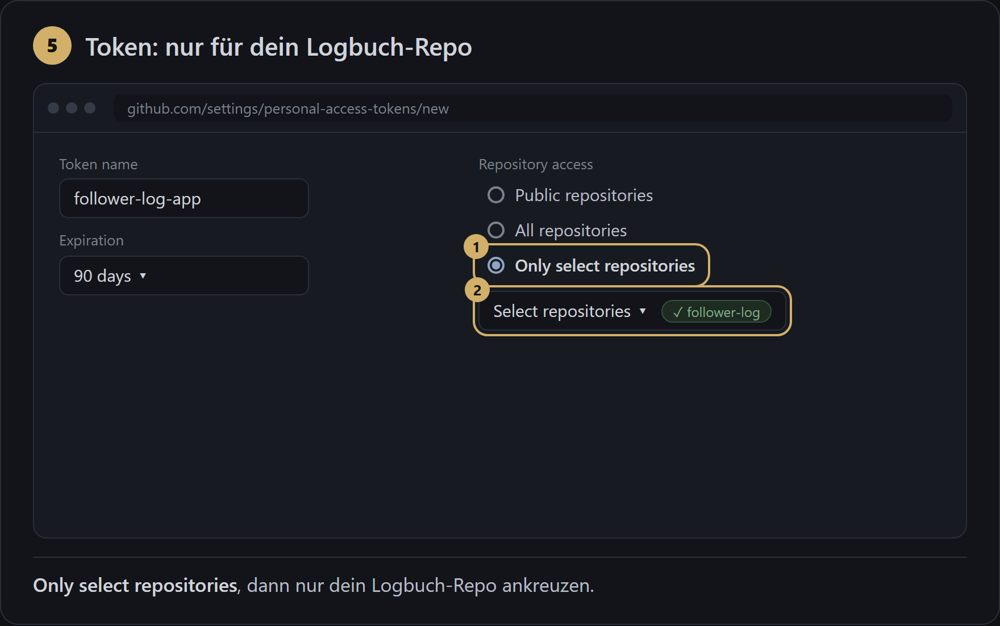

**6. Genau zwei Rechte.** Unter *Permissions* auf *Add permissions*, dann **Actions** und **Contents** auswählen. Actions auf **Read and write** stellen (damit die App den Workflow starten kann), Contents auf **Read-only** lassen (damit sie das Logbuch lesen, aber nichts ändern kann). *Metadata* setzt GitHub von selbst dazu. Dann *Generate token*.

Bild zu Schritt 6

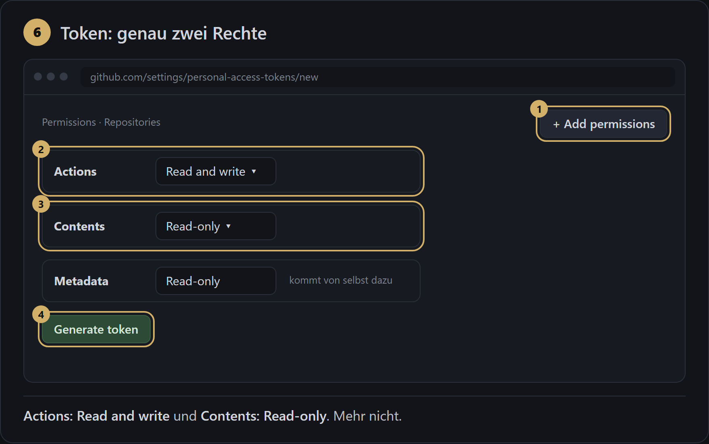

**7. Token kopieren.** GitHub zeigt ihn ein einziges Mal, er beginnt mit `github_pat_`. Sofort kopieren. Behandle ihn wie ein Passwort: nicht verschicken, nirgends posten. Geht er verloren oder läuft er ab, löschst du ihn auf derselben Seite und legst einen neuen an.

Bild zu Schritt 7

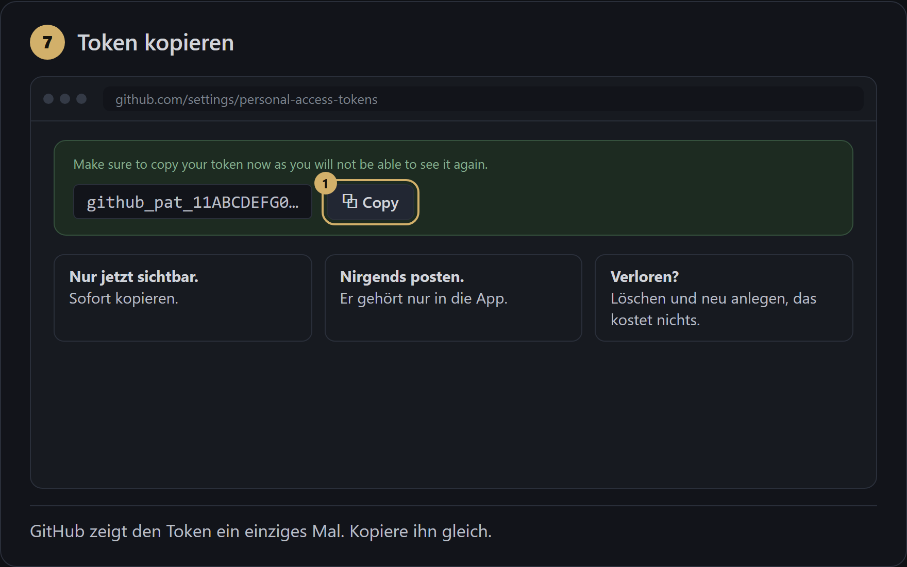

### Teil C: die App

**8. App öffnen und eintragen.** Auf dem Handy https://dennismit2n.github.io/follower-log-vorlage/ öffnen. Beim ersten Mal geht das Fenster *Einstellungen* von selbst auf, später über das Zahnrad. *Repository*: dein Konto und der Repo-Name mit Schrägstrich, zum Beispiel `deinkonto/follower-log`. *Workflow-Datei* bleibt, wie sie ist. *Token*: einfügen. Nach *Speichern* legt die App sofort los.

Bild zu Schritt 8

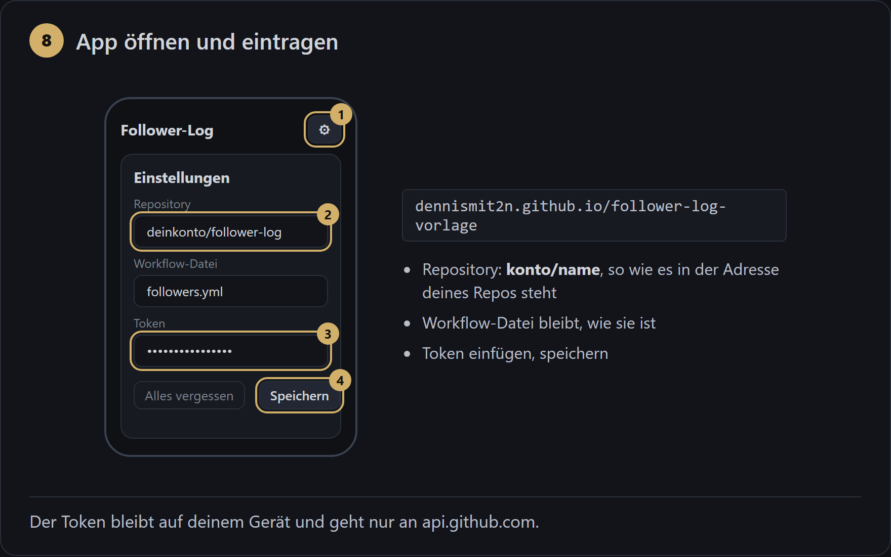

**9. Auf den Startbildschirm legen.** Android (Chrome oder Edge): oben in der App auf *Installieren* tippen und bestätigen. Fehlt der Knopf, steht im Browser-Menü mit den drei Punkten *App installieren* oder *Zum Startbildschirm hinzufügen*. iPhone (Safari): Teilen-Symbol, dann *Zum Home-Bildschirm*. Auf dem iPhone trägst du die Einstellungen aus Schritt 8 am besten erst in der installierten App ein, weil sie je Browser gelten.

Bild zu Schritt 9

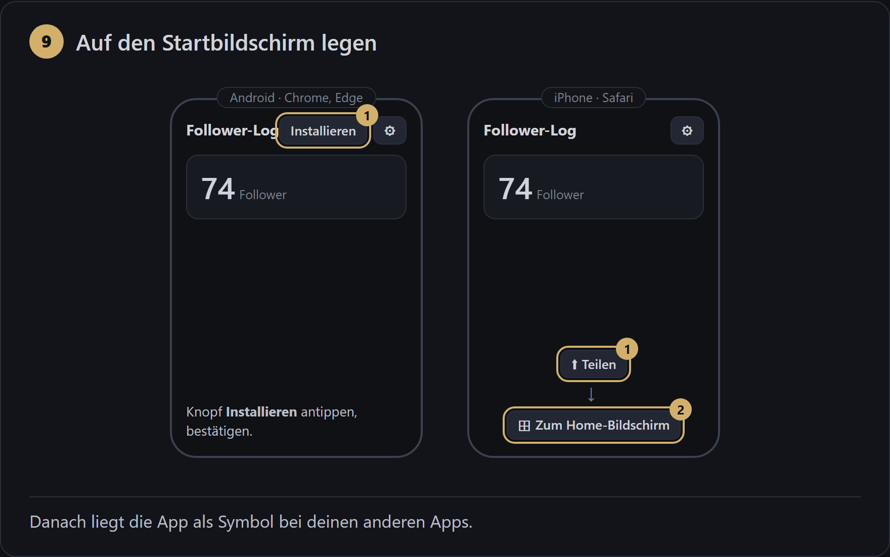

**10. Fertig.** Bei jedem Öffnen fragt die App GitHub, wann der Workflow zuletzt lief. Ist das länger als 178 Minuten her, startet sie ihn, wartet etwa eine halbe Minute und zeigt das Ergebnis. Sonst lädt sie nur das Logbuch neu und sagt, ab wann der nächste Abruf geht.

Bild zu Schritt 10

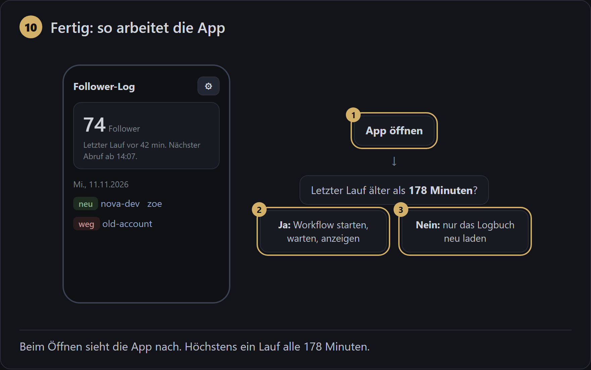

### Sicherheit in Kürze

Der Token bleibt nur auf deinem Gerät gespeichert und geht ausschließlich an `api.github.com`. Die App hat keinen eigenen Server, sammelt nichts und zählt keine Besuche. Unter ⚙ *Alles vergessen* löscht Token und Daten vom Gerät. Auf GitHub kannst du den Token jederzeit löschen, dann ist er sofort wertlos.

### Wenn etwas hakt

| Meldung in der App | Was hilft |
|---|---|
| Token ungültig oder abgelaufen | Neuen Token anlegen (Schritte 4 bis 7) und unter ⚙ eintragen |
| Repo oder Workflow nicht gefunden | Schreibweise von `konto/name` prüfen, oder der Token gilt nicht für dieses Repo (Schritt 5) |
| Token darf das nicht | Ein Recht fehlt: Actions *Read and write*, Contents *Read-only* (Schritt 6) |

## Uhrzeit ändern

In `.github/workflows/followers.yml` steht `- cron: "9 9 * * *"`. Die erste Zahl ist die Minute, die zweite die Stunde, beides in UTC. Für 18:30 UTC also `"30 18 * * *"`. MEZ ist UTC plus eine Stunde, MESZ plus zwei. GitHub startet geplante Läufe oft etwas später als angegeben, manchmal eine Stunde und mehr.

Die Sperre der App steht in `docs/app.js` ganz oben: `const SPERRE_MS = 178 * 60 * 1000;`.

## App selbst hosten

Lieber eine eigene Adresse? Die App liegt komplett in `docs/` und braucht keinen Bauschritt. Jeder statische Webspace mit HTTPS reicht. GitHub Pages geht für private Repos nur mit einem bezahlten Konto; mit einem öffentlichen Zweit-Repo nur für den Ordner `docs/` klappt es kostenlos.

## Dateien

| Datei | Aufgabe |
|---|---|
| `.github/workflows/followers.yml` | der tägliche Lauf, auch von Hand und aus der App startbar |
| `.github/logbuch.py` | vergleicht die Listen und schreibt `log.md` |
| `docs/` | die App: `index.html`, `app.js`, `style.css`, Service Worker, Manifest, Icons |
| `docs/anleitung/` | die Anleitung in Bildern als Seite, dazu die zehn Bilder und das bewegte Bild |
| `tools/` | baut die Bilder der Anleitung neu (nur nötig, wenn du die Anleitung änderst) |

Die Vorlage selbst führt den Workflow nicht aus, erst deine Kopie.

Lizenz: MIT. Gebaut von [Dennis_mit_2n](https://dennismit2n.github.io/).
